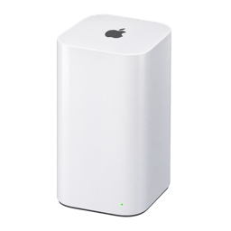

# Apple Time Capsule

Apple Time Capsule is a custom Home Assistant integration that monitors an
Apple AirPort Time Capsule over your local network. It uses SSH to read the
device's temperature, fan speed, disk space, and drive health. Setup is
entirely in the Home Assistant UI, and readings refresh every 60 seconds.

## What you can monitor

| On the Home Assistant device page | What it shows |
| --- | --- |
| **Sensors** | The internal drive's total, used, and free space. Disk sizes default to TB with one decimal place. **Disk Used Percentage** and **Disk Free Percentage** are separate sensors. |
| **Sensors → SMART Status** | A drive health summary: **Passed**, **Failed**, **Unknown**, **Disabled**, or **Not Supported**. A drive-reported failure or a critical attribute at or below its threshold sets **Failed**. An incomplete report shows **Unknown**. |
| **Diagnostics → Last Successful Reading** | When the most recent hardware reading arrived, with timestamps for each check. |
| **Diagnostics → Backup Volume Mounted** | Whether the internal backup filesystem is mounted. |
| **Diagnostics → SMB Port Open and SMB Share Accessible** | Optional checks from Home Assistant for TCP port 445 and read-only access to the configured share. |
| **Sensors → Temperature** | A single reading, using drive temperature when available, then airflow temperature or a Time Capsule temperature reading. |
| **Diagnostics → Fan Speed** | Fan speed in RPM. |
| **Diagnostics → Drive health readings** | Reallocated sectors, pending sectors, offline uncorrectable sectors, reported uncorrectable errors, spin retries, Ultra DMA CRC errors, power cycles, and power-on days. Readings appear when the drive reports them. |

If an automation uses a retired temperature sensor, open **Settings → System
→ Repairs**. Update the automation to use **Temperature** and review its
threshold in the displayed unit.

## Before you install

- **Enable SSH on the Time Capsule.** Stock firmware doesn't allow SSH logins.
  [TimeCapsuleSMB](https://github.com/jamesyc/TimeCapsuleSMB) can enable SSH when
  you add the device in its macOS app or run `tcapsule configure` in the CLI.
  The integration only needs SSH access; it doesn't require a Samba installation.
- **Have the device password handy.** Use the Time Capsule's base station admin
  password, the same one you enter in TimeCapsuleSMB.
- **Choose an address Home Assistant can reach.** Use a hostname that resolves
  from Home Assistant or an IP address. If you use an IP address, reserve it in
  your router's DHCP settings so it stays the same.

AirPort Extreme compatibility is unverified.

## Install

### HACS (recommended)

You can also open **HACS → ⋮ → Custom repositories**, add
`https://github.com/mdevils/hass-time-capsule` with the type **Integration**,
then find **Apple Time Capsule** and download it. Restart Home Assistant.

### Manual

Download the source archive from the [latest release](https://github.com/mdevils/hass-time-capsule/releases/latest).
Copy the whole `custom_components/time_capsule` folder into Home Assistant's
`config/custom_components/` directory, then restart Home Assistant.

## Connect your Time Capsule

1. After restarting Home Assistant, open **Settings → Devices & services →
   Integrations**. If your fifth-generation Time Capsule appears under
   **Discovered** via Bonjour, select **Configure**. Otherwise, choose
   **Add integration → Apple Time Capsule → Enter address manually**.
2. Enter the Time Capsule's hostname or IP address, SSH username (default
   `root`), SSH port (default `22`), and base station admin password.
   Bonjour discovery fills in the Time Capsule's IP address.
3. Submit the form. Home Assistant checks the SSH login and runs the sensor
   commands before it saves the connection.

Home Assistant uses the base station name from AirPort Utility when it can
read it. If you rename the base station in AirPort Utility, reload the
integration entry to pick up the new name. To edit the connection details,
open the integration entry menu and select **Reconfigure**. Existing sensors
keep their IDs and history when the address changes. Home Assistant remembers
the SSH key on the first successful poll after upgrading. An announcement from
a known Time Capsule can update its address after the SSH key is verified.

If setup reports a connection error, check the address, port, and whether
SSH is enabled and reachable from Home Assistant. If it reports an
authentication error, check the SSH username and base station admin password.
If sensors become unavailable, check **Last Successful Reading** on the
device page. If Home Assistant asks you to sign in again after setup, see
[Update a rejected SSH password](#update-a-rejected-ssh-password).

## Check the backup volume and share

**Backup Volume Mounted** checks the internal data volume, including when disk
capacity is temporarily unreadable. If SSH is unavailable, Home Assistant
shows the mount check as unavailable.

To monitor a TimeCapsuleSMB share, open the integration's **Configure** options
and enable **Monitor the SMB service**.

- **SMB Port Open** checks whether Home Assistant can open TCP port 445.
- **SMB Share Accessible** is added when you enter the share name, SMB username,
  and SMB password. It uses SMB 2 or 3 and opens the share for read-only access.
  Enter the share name by itself, such as `Data`, and use the account you
  configured for SMB. To keep its password when editing the same share and
  username, leave the password field blank.

The SMB checks keep running during an SSH outage. **SMB Share Accessible**
shows whether Home Assistant can open the share.

### Update a rejected SSH password

If the Time Capsule rejects the saved SSH password, Home Assistant keeps
running any enabled SMB checks, even after a restart. SSH readings such as
**Backup Volume Mounted** remain unavailable until SSH reconnects.

1. Go to **Settings → System → Repairs** and open the Apple Time Capsule
   sign-in repair. Enter the SSH username and current base station admin
   password. Home Assistant reloads the integration after it verifies the
   credentials.
2. On the Time Capsule device page, check that **Last Successful Reading**
   updates. If **SMB Port Open** is on and **SMB Share Accessible** is off,
   check the share name and SMB credentials under the integration's
   **Configure** options. If the SMB password also changed, update it there.

## Share diagnostics

Open the Time Capsule integration's entry menu and select **Download
diagnostics** to export the latest check results and decoded measurements.
The export omits connection and account details. See the
[hardware sample guide](tests/fixtures/README.md) to help verify an additional
model, firmware version, or replacement drive.

## Finding other network devices

Time Capsule discovery finds supported AirPort base stations that advertise
via Bonjour. For a wider inventory use your router's device integration or
[Home Assistant's Nmap Tracker](https://www.home-assistant.io/integrations/nmap_tracker/).
A scan shows the devices that respond from Home Assistant's network and does
not tell you which Wi-Fi access point each device is using. AirPort Utility
can show the status of each Time Capsule.

## How it works

Each poll opens one SSH connection and runs `envstat` for temperature and fan
speed, `atactl wd0 smart status` for drive health, and `df /dev/dk2` for disk
usage. When disk usage is unreadable, it checks the mount table separately.
The checks can fail independently. On the first successful SSH
connection after loading, it also tries `acp -q syNm` to read the base station
name.

The integration handles the older SSH algorithms the Time Capsule requires
(`diffie-hellman-group14-sha1` and `ssh-rsa`). No manual SSH client configuration
is needed in Home Assistant.

[Release history](https://github.com/mdevils/hass-time-capsule/releases) · [License](LICENSE)
